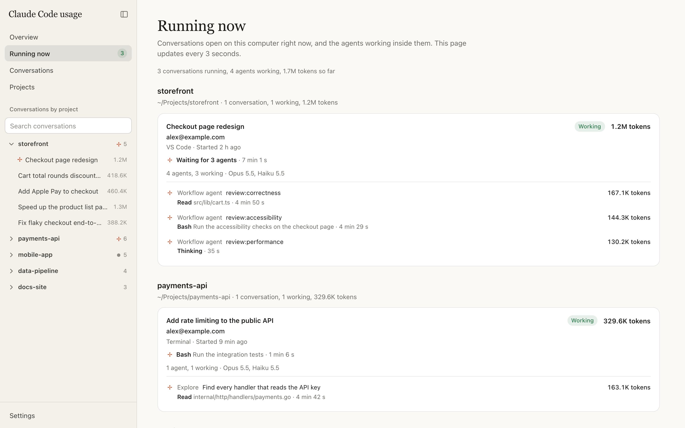
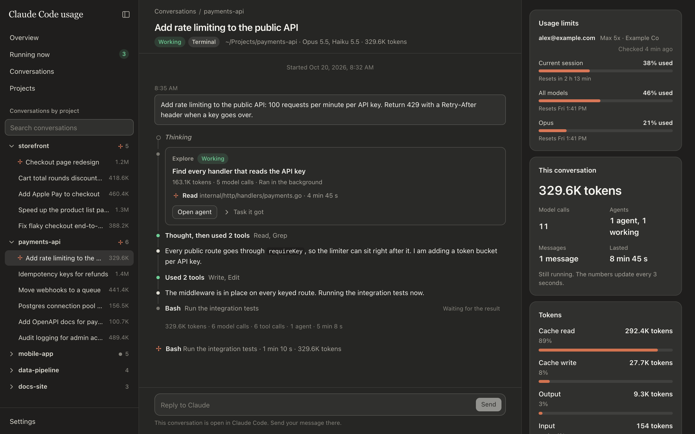
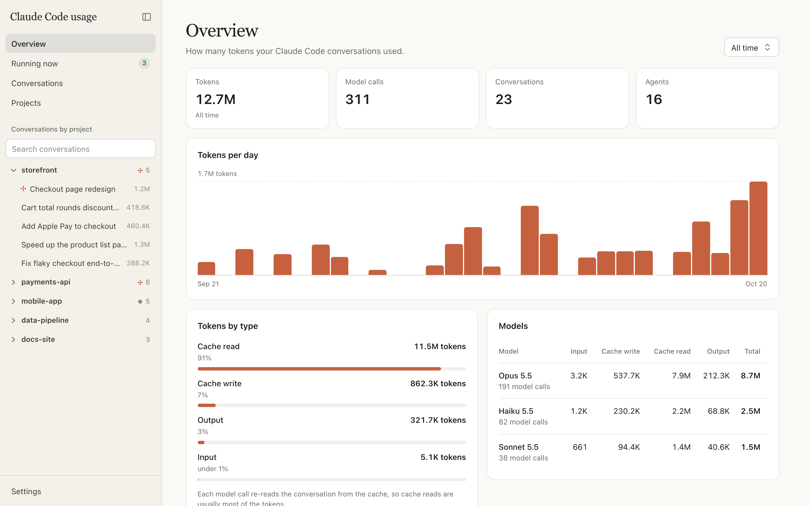

<div align="center">

# claude-dashboard

**A local dashboard for Claude Code.**

See what is running right now, what every agent is doing, and how many tokens everything used.

[](LICENSE)
[](https://nodejs.org)




</div>

## Quick start

```sh
npx -y github:DevKazonovic/claude-dashboard
```

That is the whole install, on macOS, Linux and Windows. The dashboard opens <http://127.0.0.1:3737> in your browser and runs until you press `q` or close the terminal. You only need [Node.js](https://nodejs.org) 18 or newer, which includes `npx`, and [Git](https://git-scm.com). Each run picks up the newest version.

### Run it in the background

| Command | What it does |
| --- | --- |
| `npx -y github:DevKazonovic/claude-dashboard start` | Runs it in the background, so it keeps running after you close the terminal. |
| `npx -y github:DevKazonovic/claude-dashboard status` | Shows whether it is running, and where. |
| `npx -y github:DevKazonovic/claude-dashboard stop` | Stops it. |

## Features

- **Running now.** Every open Claude Code conversation on your computer, grouped by project, with the Claude account it runs on. A live line shows what each conversation and agent is doing, such as `Bash Run the tests · 52 s`.
- **Chat view.** Read any conversation the way the Claude Code panel in VS Code shows it. Thinking and tool calls fold into one line; open it to see every model call, its tokens, and each tool's input and output.
- **Agents and workflows.** Subagents and workflow agents show as cards in the chat. Open one to read its whole run in a side panel, live while it works.
- **Tokens.** Tokens per day, week or month, split into input, output, cache write and cache read, per model, conversation, project and reply.
- **Usage limits.** The session and weekly limits of every Claude account signed in to Claude Code on your computer.
- **Reply from the page.** Send a message to a finished conversation without opening a terminal.
- Light and dark mode, and a shareable address for every page.





## Privacy

Everything stays on your computer.

- It reads the files Claude Code saves in `~/.claude` and `~/.claude-*`, and never changes them.
- It never reads your Claude login and never contacts Anthropic or any other server. Usage limits come from the copy Claude Code saves in `.claude.json`.
- It only listens on `127.0.0.1`, so other devices on your network cannot open it.
- The one thing that writes is the reply box: sending a message runs `claude --resume <id> --print` in that conversation's folder, with your own Claude Code settings and permissions.

## Options

Add options after the command, for example `npx -y github:DevKazonovic/claude-dashboard --port 4000`.

| Option | What it does |
| --- | --- |
| `--port <number>` | Use another port. The default is 3737; if it is taken, the next free one is used. |
| `--config-dir <path>` | Also read this Claude config folder. `~/.claude` and every `~/.claude-*` folder are found automatically. Repeat it for several folders. |
| `--no-open` | Do not open the browser. |

## Keep a `claude-dashboard` command

```sh
npm install -g github:DevKazonovic/claude-dashboard
claude-dashboard
```

Run the same install line again to update, and `npm uninstall -g claude-dashboard` to remove it. With `npx`, there is nothing to update or remove.

## How tokens are counted

Claude Code saves each reply from the model in the conversation's transcript, with its token counts. The dashboard adds them up per model, conversation and project; the total is input + output + cache write + cache read.

Agent transcripts do not record all of an agent's output tokens. When Claude Code has written its own usage total into a conversation, the dashboard adds the tokens the transcripts missed and shows them as "Not in the transcripts". Until Claude Code saves its next total, a running conversation with agents can show fewer tokens than it really used.

## FAQ

**Running now is empty, but Claude Code is open.**
The dashboard finds open conversations through the small file Claude Code writes for each one in `~/.claude/sessions`. If that folder is missing or empty, update Claude Code.

**Why no Docker image?**
The dashboard needs to see which Claude Code processes are running, and the reply box runs your own `claude` command. A container cannot do either on macOS or Windows. With no dependencies, running it directly installs nothing on your computer anyway.

**The reply box says the claude command was not found on Windows.**
Replying from the page starts `claude.exe`, which comes with Claude Code's native installer. If you installed Claude Code with npm, reply in Claude Code itself.

**Where is my data stored?**
Nowhere new. The dashboard keeps what it reads in memory, and the browser only remembers your theme and which project groups you opened.

## Contributing

Issues and pull requests are welcome. There is no build step: the server is in `src/`, the page is in `public/`, and both are plain JavaScript. Clone the repo, run `npm start` in it, change a file, restart and refresh the page.

## License

[MIT](LICENSE). This is a community project, not affiliated with or endorsed by Anthropic. Claude and Claude Code are trademarks of Anthropic.
